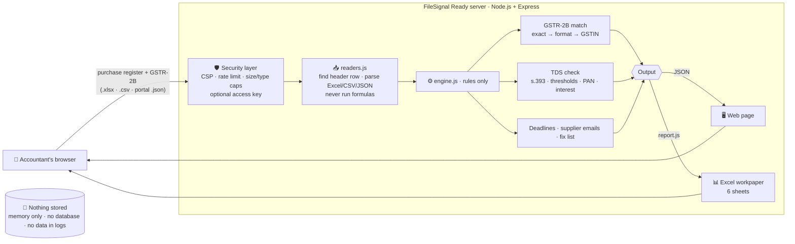
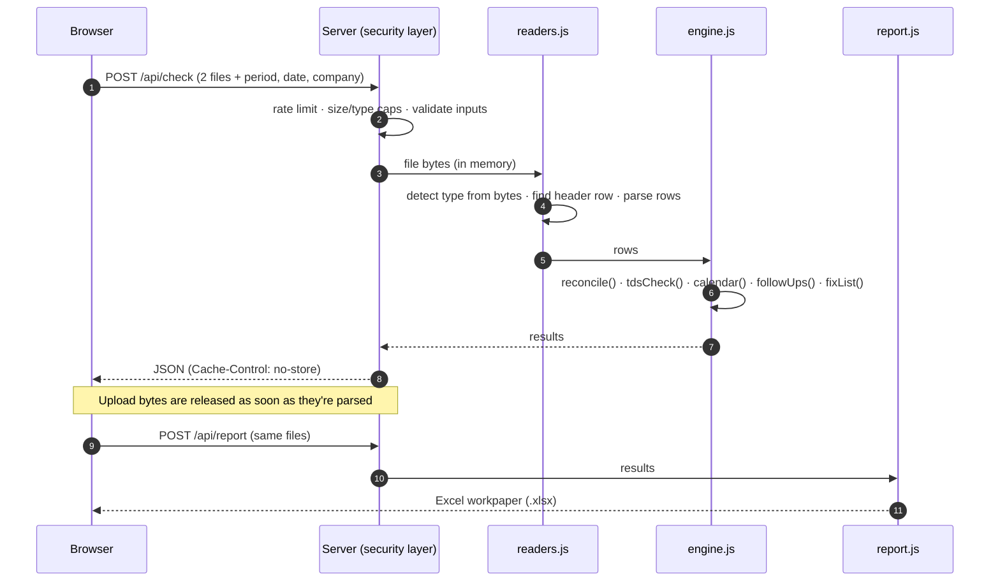
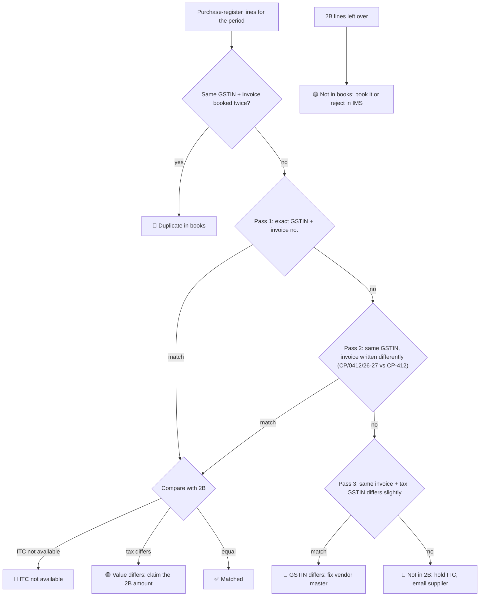

<div align="center">

# FileSignal Ready

**Know what's ready. Know when to file.**

Pre-filing GST and TDS checks for CA firms and virtual-CFO desks.
Upload a purchase register and GSTR-2B and get the ITC on hold, the TDS that was missed, a ranked fix list and an Excel workpaper, in seconds.

[](https://filesignal.onrender.com)
[](https://filesignal-watch.onrender.com)


</div>

---

## Contents

- [The problem](#the-problem)
- [What it does](#what-it-does)
- [Demo](#demo)
- [Architecture](#architecture)
- [How the checks work](#how-the-checks-work)
- [Security](#security)
- [Quick start](#quick-start)
- [API](#api)
- [Input formats](#input-formats)
- [Project structure](#project-structure)
- [Testing](#testing)
- [Deployment](#deployment)
- [Roadmap](#roadmap)
- [Limits](#limits)

---

## The problem

Every month, for every client, an accounting team has to:

| When | What | Why it hurts |
|---|---|---|
| **7th** | Deposit TDS deducted last month | Every vendor bill needs the right section, rate, threshold and PAN check |
| **11th** | File GSTR-1 (sales) | |
| **14th** | GSTR-2B is published | The government's list of what suppliers reported |
| **20th** | File GSTR-3B (pay GST, claim ITC) | **Since April 2026, the portal blocks any ITC claim above what 2B shows.** Every mismatch between the books and 2B has to be found and chased before the 20th |
| Quarterly | Form 140 (TDS return) | The Income-tax Act 2025 replaced 194C/194J with section 393 and payment codes, but the books still use the old labels |

For a desk with 50+ clients, that's days of spreadsheet matching squeezed between the 14th and the 20th.

## What it does

| | |
|---|---|
| 🔎 **GSTR-2B reconciliation** | Three-pass matching (exact → invoice-number format → GSTIN typo) plus duplicate detection. Every line gets a status and a reason |
| 💸 **ITC on hold** | What you can claim in GSTR-3B now, and exactly which invoices are blocking the rest |
| 🧾 **TDS check (s.393)** | Section from the books or inferred from the ledger, per-bill and yearly thresholds, the no-PAN rate, interest from the date TDS became due, and the 30% disallowance risk |
| ✅ **Ranked fix list** | Every action sorted by rupee impact, each with a deadline |
| ✉️ **Supplier emails** | One ready-to-send email per supplier whose invoices don't match 2B |
| 📅 **Deadline calendar** | 7th / 11th / 14th / 20th and the quarterly Form 140 |
| 📊 **Excel workpaper** | 6 sheets: Summary, Fix list, GST vs 2B, TDS check, Supplier emails, Deadlines |

**No AI model is used.** Every result comes from a written rule, and the reason is printed next to it, so a CA can audit any line in seconds. The same input always gives the same output.

## Demo

**Live:** https://filesignal.onrender.com. It opens with a fictional sample company already loaded.

On the sample month (Sunrise Foods Pvt Ltd, October 2026), it finds:

| Result | Amount |
|---|---|
| ITC claimable in GSTR-3B | ₹1,22,220 |
| **ITC on hold** | **₹51,660** across 5 invoices |
| **TDS short / not deducted** | **₹29,160** (+ ₹454 interest) |
| Items to fix | 16 |


## Architecture



### Request lifecycle



## How the checks work

### GSTR-2B matching



### TDS rules (tax year 2026-27, Income-tax Act 2025, s.393)

| Old label | New reference | Nature | Rate | Threshold |
|---|---|---|---|---|
| 194C | 393(1) Sl. 6(i) | Contract / work, incl. manpower | 1% individual/HUF, 2% others | ₹30,000 per bill or ₹1,00,000 per year |
| 194J(a) | 393(1) Sl. 6(iii) | Technical services | 2% | ₹50,000 per year |
| 194J(b) | 393(1) Sl. 6(iii) | Professional services | 10% | ₹50,000 per year |
| 194H | 393(1) Sl. 1(ii) | Commission / brokerage | 2% | ₹20,000 per year |
| 194I(a) | 393(1) Sl. 2(ii) | Rent: plant & machinery | 2% | ₹50,000 per month |
| 194I(b) | 393(1) Sl. 2(ii) | Rent: land & building | 10% | ₹50,000 per month |
| 194Q | 393(1) Sl. 8(ii) | Purchase of goods (buyer turnover > ₹10 cr) | 0.1% | On purchases above ₹50 lakh per seller |
| — | — | No valid PAN | 20% | |

- **Section:** taken from the books. If it's missing, it's inferred from the ledger name ("Legal fees" → 194J(b)). If the two disagree ("Consultancy" booked as 194C), both are computed, the higher one is shown, and the line is flagged for review.
- **Thresholds:** once a yearly limit is crossed, TDS is due on the earlier bills too. Interest runs from the date the limit was crossed, not from the first bill.
- **Interest:** 1% per month or part of a month on the shortfall.
- **Disallowance risk:** 30% of the expense when TDS wasn't deducted at all.

## Security

| Guardrail | How |
|---|---|
| Nothing stored | Uploads live in memory for one request. No disk, no database |
| No data in logs | Only method, path, status and time are logged. Never file contents, names, GSTINs or PANs |
| File checks | Type decided from the file's bytes, not its name. Only .csv / .xlsx / .json, max 10 MB, max 50,000 rows |
| Formulas never run | Excel formulas in uploads are never evaluated. Text starting with `= + - @` is neutralised in every export (CSV/Excel injection) |
| Browser hardening | Strict Content-Security-Policy (no inline or third-party scripts), no framing, no referrer, HSTS |
| Abuse limits | 30 API requests per minute per IP; request and header timeouts |
| Private mode | Set `ACCESS_KEY`; the API then requires it (constant-time comparison) |
| Errors | Specific messages for bad input, generic ones otherwise. No stack traces |
| Container | Alpine image running as the non-root `node` user |
| Dependencies | `npm audit`: 0 known vulnerabilities |

Every guardrail has a test in [`test/fileready.test.js`](test/fileready.test.js).

## Quick start

```bash
git clone https://github.com/punar4/filesignal.git
cd filesignal
npm install
npm test        # 11 tests
npm start       # http://localhost:3000
```

Requires Node.js 20 or newer.

## API

| Method | Path | Body (multipart/form-data) | Returns |
|---|---|---|---|
| `POST` | `/api/check` | `books`, `gstr2b` (files), `period` (`2026-10`), `asOf` (`2026-11-20`), `company`, `turnover10cr` (`true`/`false`) | JSON: summary, every line, fix list, emails, deadlines |
| `POST` | `/api/report` | same | Excel workpaper (.xlsx) |
| `GET` | `/health` | — | `{"ok":true}` |
| `GET` | `/samples/:name` | — | Sample files |

```bash
curl -F books=@samples/sample_purchase_register_tally_style.xlsx \
     -F gstr2b=@samples/sample_gstr2b_portal_style.xlsx \
     -F period=2026-10 -F asOf=2026-11-20 -F company="Sunrise Foods" \
     http://localhost:3000/api/check
```

If `ACCESS_KEY` is set, add `-H "x-access-key: <key>"`.

## Input formats

| File | Accepted | Notes |
|---|---|---|
| Purchase register | Tally / Zoho export, `.xlsx` or `.csv` | Title rows above the header and a "Grand Total" row are skipped automatically |
| GSTR-2B | Portal Excel (`B2B` sheet), `.csv`, or portal `.json` | The portal's two-row header ("Tax Amount" over "Integrated Tax") is merged automatically |

Columns are recognised by name, so `GSTIN/UIN`, `Supplier Invoice No.`, `Taxable Value (₹)`, `Integrated Tax Amount` and so on all work without remapping.

## Project structure

```
src/
  engine.js     rules: reconcile(), tdsCheck(), calendar(), followUps(), fixList()
  readers.js    CSV / XLSX / GST-portal JSON → rows (header detection, limits)
  report.js     6-sheet Excel workpaper, formula-injection safe
  server.js     Express API + security layer
public/         web page (no inline scripts, strict CSP)
samples/        fictional company, Oct 2026, every mismatch type planted
test/           node:test suite
Dockerfile      non-root Alpine image
render.yaml     one-click Render blueprint
```

## Testing

```bash
npm test
```

| Area | What's checked |
|---|---|
| Engine | Every planted problem found with exact amounts; GSTIN checksum; invoice-format matching; ledger → section |
| Readers | Tally-style and portal-style Excel give the same results as CSV; disguised and corrupt files rejected; formulas never evaluated |
| API | Check and Excel report end to end; formula injection neutralised; input validation; size limits; access key; rate limit |
| Web | Security headers, no path traversal, no stack traces |

## Deployment

**Render (free):** New → Blueprint → pick this repo; [`render.yaml`](render.yaml) does the rest. Render's free plan sleeps after ~15 minutes idle, so point a free [cron-job.org](https://cron-job.org) job at `/health` every 10 minutes.

**Docker:**

```bash
docker build -t filesignal . && docker run -p 3000:3000 filesignal
```

| Variable | Default | Purpose |
|---|---|---|
| `PORT` | 3000 | |
| `MAX_FILE_MB` | 10 | Per-file upload limit |
| `RATE_LIMIT` | 30 | API requests per minute per IP |
| `ACCESS_KEY` | — | Makes the app private |

## Roadmap

- [x] GSTR-2B reconciliation with three-pass matching
- [x] TDS under the Income-tax Act 2025
- [x] Excel workpaper and supplier emails
- [x] [FileSignal Watch](https://github.com/punar4/filesignal-watch): portal-downtime alerts
- [ ] Pull purchase data straight from Zoho Books
- [ ] Multi-client desk view: every client's ITC on hold and next deadline on one screen
- [ ] Help with mid-filing failures (session drops, submit errors)
- [ ] GST offline-tool upload file

## Limits

- Form 140 payment codes are not filled in, because published mappings disagree. Take them from the return preparation utility.
- GST dates assume monthly filers. QRMP (quarterly) filers use different dates.
- For yearly TDS thresholds, upload the tax year to date.
- This is a working aid, not tax advice.

---

<div align="center">

Built by **Punarnava** · Part of **FileSignal** · Know what's ready. Know when to file.

</div>
